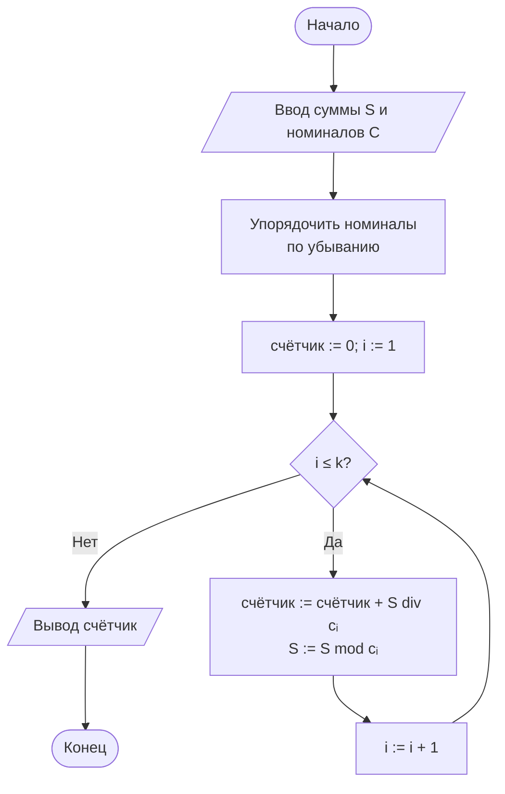

# МИНИСТЕРСТВО НАУКИ И ВЫСШЕГО ОБРАЗОВАНИЯ РОССИЙСКОЙ ФЕДЕРАЦИИ

&nbsp;

**Направление подготовки:** 38.03.05 «Бизнес-информатика»
**Дисциплина:** Теория алгоритмов

&nbsp;

# ОТЧЁТ

## по лабораторной работе № 8

## «Жадные алгоритмы и экспериментальная оценка качества приближённых решений»

**Вариант 13**

&nbsp;

|  |  |
|---|---|
| **Выполнила:** | Кугушева Арина Вячеславовна |
| **Группа:** | БИ2-1 |
| **Проверил:** | ______________________ |

&nbsp;

**2026 г.**

---

## 1. Цель работы и задание варианта

**Цель работы:** изучить жадную стратегию построения алгоритмов, установить условия, при которых она приводит к оптимальному решению, и экспериментально оценить отклонение жадного решения от оптимального в задаче, где эти условия не выполняются.

**Задание варианта 13 (табл. 1 методических указаний):**

| Параметр | Значение |
|---|---|
| Задача | Размен суммы |
| Жадный критерий 1 | Наибольший номинал |
| Жадный критерий 2 | Наименьший номинал |
| Размерность | Номиналы 1, 5, 11; $S \le 120$ |
| Дополнительное задание | Ж6 |

**Дополнительное задание Ж6:** реализовать улучшенную жадную схему (лучшее из результатов двух критериев либо локальное улучшение) и оценить прирост качества.

**Задачи работы:**

1. Реализовать жадный размен с критериями «наибольший номинал» и «наименьший номинал».
2. Реализовать точное решение (динамическое программирование) как эталон.
3. Сгенерировать серию из 500 случайных сумм, вычислить решения всеми способами и найти среднее и максимальное отклонение, долю совпадений с оптимумом.
4. Построить контрпример вручную.
5. Сравнить время работы жадного и точного алгоритмов при росте суммы.
6. Выполнить доп. задание Ж6.

---

## 2. Описание задачи и алгоритмов

### 2.1. Задача

Дана система номиналов $\{1, 5, 11\}$ и сумма $S$ ($1 \le S \le 120$). Нужно разменять $S$ **минимальным числом монет**, при этом число монет каждого номинала не ограничено. Поскольку номинал 1 присутствует, любую сумму можно разменять. Это задача **минимизации**, поэтому качество жадного решения оценивается так:

$$\rho = \frac{K_{\text{опт}}}{K_{\text{жадн}}} \le 1, \qquad \delta = \frac{K_{\text{жадн}} - K_{\text{опт}}}{K_{\text{опт}}} \cdot 100\%,$$

где $K$ — число монет. Чем меньше $\delta$, тем лучше; $\delta = 0$ означает, что жадное решение оптимально.

### 2.2. Жадный критерий 1 — наибольший номинал

Номиналы просматриваются по убыванию (11, 5, 1). Каждый номинал берётся максимально возможное число раз: $\lfloor S / c \rfloor$ монет, затем $S := S \bmod c$. Это стандартный «кассовый» алгоритм. Трудоёмкость $\Theta(k \log k)$ при $k$ номиналах (здесь $k = 3$), то есть фактически $O(1)$ по $S$.

### 2.3. Жадный критерий 2 — наименьший номинал

Номиналы просматриваются по возрастанию (1, 5, 11). Первым берётся номинал 1, он «съедает» всю сумму: получается ровно $S$ монет. Критерий всегда допустим, но по смыслу очень слабый: он игнорирует крупные номиналы.

### 2.4. Точный алгоритм (динамическое программирование)

Пусть $d[x]$ — минимальное число монет для суммы $x$. Тогда

$$d[0] = 0, \qquad d[x] = 1 + \min_{c \in C,\ c \le x} d[x - c].$$

Это следует из оптимальной подструктуры: последняя монета $c$ — какая-то из номиналов, а остаток $x-c$ должен быть разменян оптимально. Трудоёмкость $\Theta(S \cdot k)$, память $\Theta(S)$.

### 2.5. Улучшенные схемы (Ж6)

1. **Лучшее из двух критериев:** $\min(K_1, K_2)$.
2. **Локальное улучшение (перебор первой монеты):** вместо того чтобы сразу брать наибольший номинал, перебираются все допустимые первые монеты $c$; для каждой остаток $S - c$ размениваются жадно по наибольшему номиналу, выбирается лучший вариант. Трудоёмкость остаётся $O(k^2)$ — не зависит от $S$.

---

## 3. Блок-схема жадного алгоритма (критерий 1)



---

## 4. Листинг программы

Программа написана на Python 3.10+ и запускается в PyCharm командой **Run** (файл `main.py`, сторонние библиотеки не нужны). К каждой строке даны пояснения в комментариях.

```python
"""ЛР № 8, вариант 13. Размен суммы: номиналы 1, 5, 11; S <= 120.
Критерий 1 - наибольший номинал, критерий 2 - наименьший, Ж6 - улучшенная схема."""
import random      # генерация случайных сумм
import statistics  # среднее и медиана
import time        # замер времени работы

COINS = [1, 5, 11]  # система номиналов варианта
S_MAX = 120         # максимальная размениваемая сумма


def coins_dp(s, coins):
    """Точный алгоритм (ДП): минимальное число монет для суммы s."""
    d = [0] * (s + 1)                                   # d[x] - минимум монет для суммы x; d[0] = 0
    for x in range(1, s + 1):                           # перебираем все суммы от 1 до s
        d[x] = min(d[x - c] for c in coins if c <= x) + 1  # последняя монета c: берём лучший вариант
    return d[s]                                         # ответ для исходной суммы


def greedy(s, coins, largest=True):
    """Жадный размен: largest=True - наибольший номинал, False - наименьший."""
    count = 0                                           # счётчик монет
    for c in sorted(coins, reverse=largest):            # порядок номиналов задаёт критерий выбора
        count += s // c                                 # берём монету c максимально возможное число раз
        s %= c                                          # остаток суммы после этого
    return count                                        # число использованных монет


def greedy_improved(s, coins):
    """Ж6: перебор первой монеты (локальное улучшение), дальше - жадно по наибольшему."""
    return min(1 + greedy(s - c, coins) for c in coins if c <= s)  # лучшая первая монета + жадный хвост


def best_of_two(s, coins):
    """Ж6: лучшее из результатов двух критериев."""
    return min(greedy(s, coins, True), greedy(s, coins, False))    # меньшее из двух чисел монет


def evaluate(name, func, sums):
    """Отклонение func от оптимума на списке сумм; печатает строку таблицы."""
    dev, hits = [], 0                                   # отклонения и число точных совпадений
    for s in sums:                                      # проходим по всем наборам данных
        opt, got = coins_dp(s, COINS), func(s, COINS)   # эталон и проверяемый алгоритм
        dev.append((got - opt) / opt * 100)             # относительное отклонение, % (минимизация)
        hits += got == opt                              # считаем совпадения с оптимумом
    print(f"{name:<28}{statistics.mean(dev):>10.2f}{statistics.median(dev):>10.2f}"
          f"{max(dev):>10.2f}{hits / len(sums) * 100:>10.1f}%")  # среднее, медиана, максимум, доля


if __name__ == "__main__":
    # --- Контрпример: наименьшая сумма, на которой жадный (наибольший) неоптимален ---
    s0 = next(s for s in range(1, S_MAX + 1) if greedy(s, COINS) != coins_dp(s, COINS))  # поиск
    print(f"Контрпример: S = {s0}, жадно {greedy(s0, COINS)} монет, оптимум {coins_dp(s0, COINS)}")
    bad = [s for s in range(1, S_MAX + 1) if greedy(s, COINS) != coins_dp(s, COINS)]     # все плохие S
    print(f"Сумм, где жадный неоптимален: {len(bad)} из {S_MAX}\n")

    # --- Серия из 500 случайных сумм и полный перебор S = 1..120 ---
    rng = random.Random(2024)                           # фиксированное зерно - результат повторяем
    sets = {"500 случайных S": [rng.randint(1, S_MAX) for _ in range(500)],
            "все S от 1 до 120": list(range(1, S_MAX + 1))}
    for title, sums in sets.items():                    # две серии данных
        print(f"{title}\n{'Алгоритм':<28}{'среднее,%':>10}{'медиана,%':>10}{'макс,%':>10}{'оптимум':>11}")
        evaluate("Ж1: наибольший номинал", lambda s, c: greedy(s, c, True), sums)
        evaluate("Ж2: наименьший номинал", lambda s, c: greedy(s, c, False), sums)
        evaluate("Ж6: лучшее из двух", best_of_two, sums)
        evaluate("Ж6: перебор 1-й монеты", greedy_improved, sums)
        print()

    # --- Время работы при росте суммы ---
    print(f"{'S':>9}{'жадный, с':>14}{'ДП, с':>12}{'отношение':>12}")
    for s in [10 ** 3, 10 ** 4, 10 ** 5, 10 ** 6]:      # растущая размерность
        t0 = time.perf_counter(); greedy(s, COINS); t_g = time.perf_counter() - t0       # время жадного
        t0 = time.perf_counter(); coins_dp(s, COINS); t_dp = time.perf_counter() - t0    # время ДП
        print(f"{s:>9}{t_g:>14.7f}{t_dp:>12.4f}{t_dp / t_g:>12.0f}")
```

---

## 5. Результаты серии экспериментов

Использовано две серии данных: **500 случайных сумм** $S \in [1, 120]$ (`seed = 2024`) и **полный перебор всех 120 сумм** (для детерминированной оценки). Реализованы четыре алгоритма: критерий 1 (наибольший номинал), критерий 2 (наименьший номинал) и две схемы Ж6.

**Таблица 1. Отклонение жадных решений от оптимума (500 случайных сумм)**

| Алгоритм | Среднее отклонение, % | Медиана, % | Максимум, % | Доля совпадений с оптимумом |
|---|---|---|---|---|
| Критерий 1: наибольший номинал | 4,47 | 0,00 | 66,67 | 84,6 % |
| Критерий 2: наименьший номинал | 701,55 | 760,00 | 1000,00 | 2,4 % |
| Ж6: лучшее из двух критериев | 4,47 | 0,00 | 66,67 | 84,6 % |
| Ж6: перебор первой монеты | 2,11 | 0,00 | 50,00 | 91,6 % |

**Таблица 2. То же для всех сумм $S = 1, \dots, 120$**

| Алгоритм | Среднее отклонение, % | Медиана, % | Максимум, % | Доля совпадений с оптимумом |
|---|---|---|---|---|
| Критерий 1: наибольший номинал | 4,92 | 0,00 | 66,67 | 83,3 % |
| Критерий 2: наименьший номинал | 687,67 | 746,43 | 1000,00 | 3,3 % |
| Ж6: лучшее из двух критериев | 4,92 | 0,00 | 66,67 | 83,3 % |
| Ж6: перебор первой монеты | 2,24 | 0,00 | 50,00 | 91,7 % |

Критерий 1 неоптимален на **20 из 120** сумм: 15, 20, 26, 31, 37, 42, 48, 53, 59, 64, 70, 75, 81, 86, 92, 97, 103, 108, 114, 119. Максимальное отклонение (66,67 %) достигается на $S = 15$. Критерий 2 совпадает с оптимумом только при $S \in \{1,2,3,4\}$ (в этих случаях номинал 1 — единственный разумный выбор); на остальных суммах отклонение огромно (до 1000 % при $S = 120$: 120 монет вместо 11).

### 5.1. Дополнительное задание Ж6 — прирост качества

* **Лучшее из двух критериев** не даёт никакого прироста (средние отклонения в таблицах совпадают). Причина: критерий 2 всегда использует ровно $S$ монет, а критерий 1 — не больше $S$ (так как номинал 1 присутствует); поэтому $\min(K_1, K_2) = K_1$ всегда.
* **Перебор первой монеты** улучшает результат: на полном наборе средняя ошибка снижается с 4,92 % до 2,24 % (в 2,2 раза), максимальная — с 66,67 % до 50,00 %, доля точных решений растёт с 83,3 % до 91,7 %. Схема исправляет 10 из 20 «плохих» сумм (15, 26, 37, 48, 59, 70, 81, 92, 103, 114), но остаётся неоптимальной на суммах 20, 31, 42, 53, 64, 75, 86, 97, 108, 119. Например, для $S = 20$ оптимум — четыре монеты по 5, а перебор первой монеты даёт 6 монет, так как после первого выбора дальше действует всё то же жадное правило. Следовательно, локальное улучшение уменьшает ошибку, но не устраняет её.

---

## 6. Контрпример, разобранный вручную

Система номиналов $\{1, 5, 11\}$, сумма $S = 15$ (найдена программой как наименьшая сумма с неоптимальным жадным решением; для $S = 1, \dots, 14$ жадное решение оптимально).

**Жадный алгоритм (наибольший номинал):**

1. $15 \div 11 = 1$ (остаток 4) → берём одну монету 11.
2. $4 \div 5 = 0$ → монета 5 не помещается.
3. $4 \div 1 = 4$ → берём четыре монеты по 1.

Итого $11 + 1 + 1 + 1 + 1$ — **5 монет**.

**Точный алгоритм (ДП).** Таблица $d[x]$:

| $x$ | 0 | 1 | 2 | 3 | 4 | 5 | 6 | 7 | 8 | 9 | 10 | 11 | 12 | 13 | 14 | 15 |
|---|---|---|---|---|---|---|---|---|---|---|---|---|---|---|---|---|
| $d[x]$ | 0 | 1 | 2 | 3 | 4 | 1 | 2 | 3 | 4 | 5 | 2 | 1 | 2 | 3 | 4 | **3** |

Для $x = 15$: $d[15] = 1 + \min(d[14],\ d[10],\ d[4]) = 1 + \min(4,\ 2,\ 4) = 3$. Оптимум — $5 + 5 + 5$, **3 монеты**.

**Отклонение:** $\delta = (5 - 3)/3 \cdot 100\% = 66{,}7\%$, коэффициент качества $\rho = 3/5 = 0{,}6$.

**Причина ошибки.** Жадный выбор монеты 11 оставляет остаток 4, который можно разменять только мелочью (номиналом 1). Обратная ситуация — три монеты по 5 — полностью исчерпывает сумму. То есть жадный выбор «самое крупное» не входит ни в одно оптимальное решение: **свойство жадного выбора не выполняется**. Для системы $\{1, 5, 10\}$ такого эффекта нет (каждый номинал кратен предыдущему), а для $\{1, 5, 11\}$ число 11 не кратно 5, и система неканоническая. Неоптимальные суммы повторяются с периодом 11: две серии — 15, 26, 37, … и 20, 31, 42, ….

---

## 7. Сравнение времени работы

Измерения выполнены в среде Linux, Python 3.12, номиналы 1, 5, 11, сумма $S$ увеличивалась до $10^6$.

**Таблица 3. Время работы алгоритмов**

| $S$ | Жадный, с | ДП, с | Отношение |
|---|---|---|---|
| 1 000 | 0,0000045 | 0,0009 | 202 |
| 10 000 | 0,0000051 | 0,0092 | 1 826 |
| 100 000 | 0,0000068 | 0,0997 | 14 595 |
| 1 000 000 | 0,0000155 | 0,5819 | 37 469 |

Время ДП растёт линейно с $S$ ($\Theta(S \cdot k)$), а время жадного алгоритма практически не зависит от $S$: он выполняет всего $k = 3$ деления. Поэтому разрыв увеличивается с ростом суммы: при $S = 10^6$ ДП медленнее более чем в 37 тысяч раз. (Абсолютные значения времени зависят от компьютера и немного меняются от запуска к запуску.)

---

## 8. Выводы

1. Жадный алгоритм по критерию «наибольший номинал» для системы $\{1, 5, 11\}$ **не оптимален**: он даёт точное решение на 83–85 % сумм, но ошибается на каждой 6-й сумме. Среднее отклонение 4,5–4,9 %, максимальное — 66,7 % ($S = 15$: 5 монет вместо 3). Гарантий качества алгоритм не даёт.
2. Критерий «наименьший номинал» практически бесполезен: среднее отклонение около 700 %, точное совпадение лишь на 4 суммах из 120. Это подтверждает, что качество жадного алгоритма определяется не самой стратегией, а выбранным критерием упорядочивания.
3. Контрпример $S = 15$ показывает механизм ошибки: жадный выбор самого крупного номинала оставляет «неудобный» остаток, который можно покрыть только мелкими монетами. Система $\{1, 5, 11\}$ неканоническая, и оптимальность жадности для неё нарушается.
4. Улучшенная схема Ж6 «лучшее из двух критериев» прироста не даёт, так как критерий 2 всегда не лучше критерия 1. Схема «перебор первой монеты» снижает среднее отклонение более чем вдвое (4,92 % → 2,24 %) и повышает долю точных решений до 91,7 %, сохраняя трудоёмкость, не зависящую от $S$, но полностью ошибку не устраняет (остаётся 10 неоптимальных сумм).
5. По скорости жадный алгоритм многократно превосходит ДП, причём разрыв растёт с $S$ ($O(1)$ против $\Theta(S \cdot k)$).
6. **Рекомендация.** Для канонических систем номиналов (например, 1, 2, 5, 10) жадный размен следует применять — он оптимален и мгновенен. Для произвольных систем, как 1, 5, 11, если нужен гарантированный минимум монет, следует использовать динамическое программирование (его стоимость при $S \le 120$ ничтожна). Жадный алгоритм допустим как быстрое приближение, если потери (в среднем несколько процентов) приемлемы, но величину потерь нужно оценивать экспериментально, а не постулировать.
